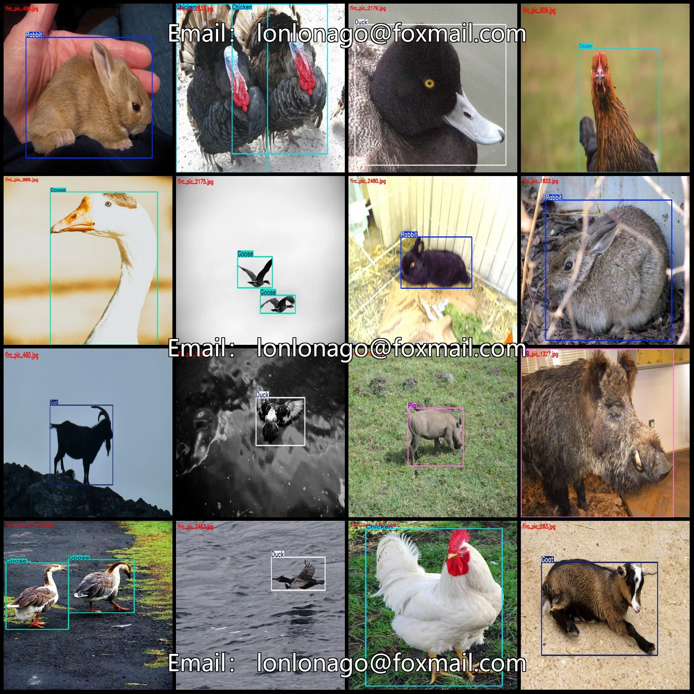
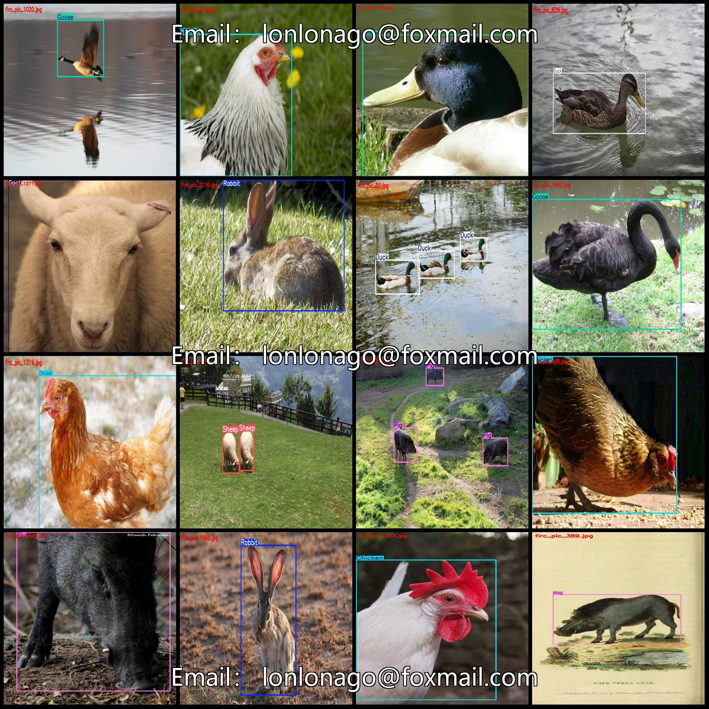
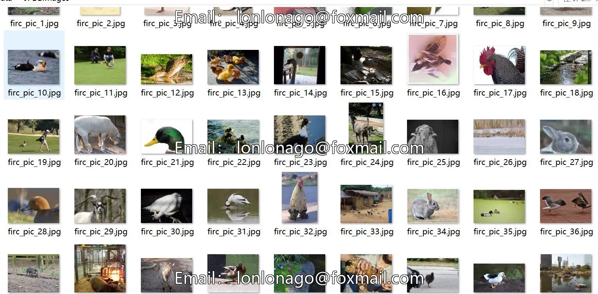
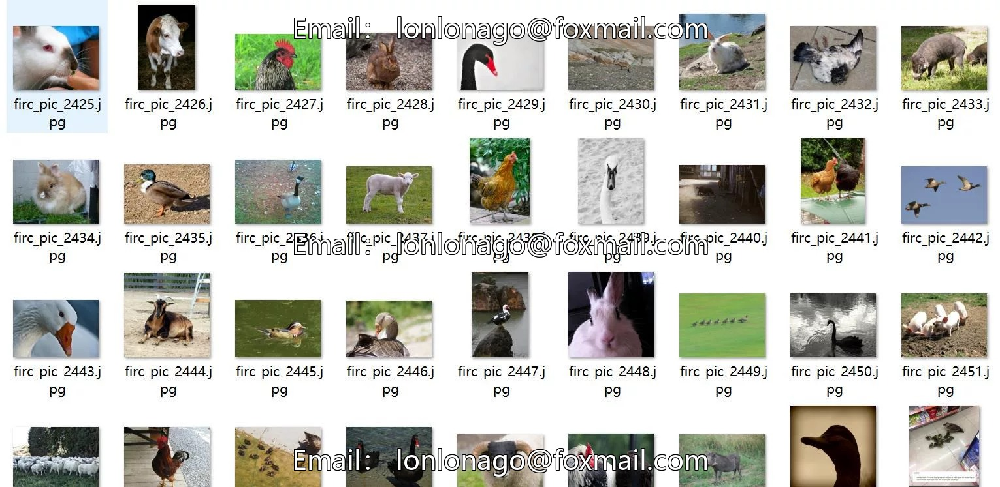

# Poultry detection dataset VOC+YOLO format with 2558 images in 8 categories

## Body

Poultry Detection Dataset VOC+YOLO format with 2558 images in 8 categories
Tips: Due to the dataset's replicability, please confirm compliance before purchasing.
Dataset format: Pascal VOC format + YOLO format (txt file without split path, only containing jpg images and corresponding VOC format xml files and yolo format txt files)
Number of images (number of jpg files): 2558
Number of annotations (number of xml files): 2558
Number of annotations (number of txt files): 2558
Number of annotation categories: 8

Label category names (Note that the order of yolo format categories does not correspond to this, but is based on the classes.txt in the labels folder): ["Cattle", "Chicken", "Duck", "Goat", "Goose", "Pig", "Rabbit", "Sheep"]
Number of boxes labeled in each category
Cattle (Cows = 276
Chicken (Chickens = 607
Duck (duck) Frames = 873
Goat (sheep) Frames = 335
Goose (turkey) Frames = 445
Pig (Pig) Frames = 361

Rabbit (rabbit) Frames = 345
Sheep (Sheep = 211
Total frame count: 3453
Number of images per category
Cattle (Number of images owned by the cow = 232
Chicken (Chickens) Number of pictures owned = 525
Duck (duck) occupies a picture count = 423
Goat (sheep) occupies a picture count = 296
Goose (swan) occupies a picture count = 322
Pig (pig) occupies a picture count = 285
Rabbit (rabbit) occupies a picture count = 329
Sheep (Sheep) Number of pictures owned = 146

Image resolution: Multi-resolution images, such as 1024x666, 1024x683, etc.
Using labeling tool: labelImg
Labeling rules: Draw a rectangle around the category.
Important note: The dataset does not have separate training, validation, and test sets; you need to partition them yourself.
Special declaration: This dataset does not guarantee the accuracy of the trained models or weight files.

## Images

## Payment

Here is a pay link on Stripe ( https://buy.stripe.com/3cs8yP7sY87d0vu9AB ). Please contact me lonlonago@foxmail.com after funding $89, and I will send you a complete data files , thank you!

